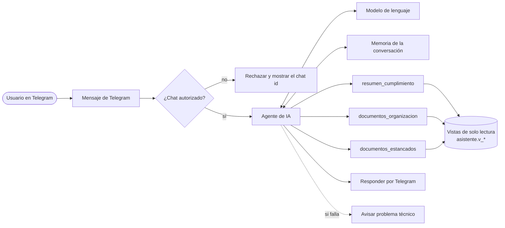

# Agente de IA para consultar el cumplimiento SST / PESV


Asistente conversacional en **n8n** que responde, en lenguaje natural y por **Telegram**, preguntas sobre el avance documental del SG-SST y el PESV de cada organización. Consulta la base [`proyecto_base_de_datos_en_PostgreSQL`](https://github.com/sebastianace/proyecto_base_de_datos_en_PostgreSQL) **sin modificarla**.

El punto central del diseño: **el modelo de IA no escribe SQL**. Solo puede elegir entre 3 herramientas, cada una con una consulta fija sobre vistas de solo lectura, y se conecta con un rol de PostgreSQL que no puede leer datos personales ni escribir nada.

<!-- Cuando tengas la captura de una conversación real, guárdala como docs/img/conversacion.png y quita las marcas de comentario de la línea siguiente:

-->

## Ejemplos de preguntas

- ¿Cómo va el cumplimiento de Transportes del Oriente?
- ¿Qué organización tiene el menor cumplimiento en PESV?
- Muéstrame los documentos en borrador de Constructora Andina.
- ¿Qué documentos llevan más de 30 días sin cambios?

## Cómo funciona



| Herramienta | Qué responde | Parámetros que elige el modelo |
|---|---|---|
| `resumen_cumplimiento` | Porcentaje de documentos finalizados por organización y sistema | organización, sistema |
| `documentos_organizacion` | Documentos de una organización, con estado y días sin cambios | organización, estado, límite |
| `documentos_estancados` | Documentos sin finalizar que llevan N días o más sin cambios | días mínimos |

Hay **dos versiones** del workflow, con el mismo agente y las mismas herramientas:

| Archivo | Para qué sirve |
|---|---|
| `workflows/01_agente_telegram.json` | Uso real: responde por Telegram, solo a chats autorizados |
| `workflows/02_agente_chat_local.json` | Para probarlo en local con el chat de n8n, sin crear un bot |

## Seguridad

Un agente decide por su cuenta qué consultar, así que la seguridad no puede depender solo del prompt. Está en capas:

1. **Sin SQL libre.** Cada herramienta ejecuta una consulta fija; el modelo solo da valores para los parámetros (`$1`, `$2`…), que nunca se concatenan al texto. Hay una prueba de inyección SQL.
2. **Rol de mínimo privilegio.** `asistente_ia` solo puede leer dos vistas (`asistente.v_cumplimiento` y `asistente.v_documentos`). No puede leer las tablas, ni `persons` (cédulas, correos, teléfonos), ni crear, modificar o borrar nada. Las pruebas lo verifican.
3. **Solo organizaciones activas** y filas limitadas (20, 25 y 15 como máximo por herramienta). Si hay más coincidencias, la consulta lo informa y el agente avisa.
4. **Lista de chats autorizados.** Un bot de Telegram es público: cualquiera puede escribirle. Solo responde a los chats de `chat_ids_permitidos`; a los demás les dice su chat id para que el administrador lo agregue.
5. **Prompt con reglas** (no inventar, solo consultar, ignorar instrucciones dentro de los datos). Es una capa más, **no** la garantía: la garantía son las capas 1 a 3.
6. **Si el modelo falla**, el usuario recibe un aviso en lugar de silencio.

**Privacidad:** los resultados de las consultas (nombres de organizaciones y títulos de documentos) se envían al proveedor del modelo de lenguaje. No incluyen datos personales de trabajadores, pero elige un proveedor adecuado para tus datos. Algunos planes gratuitos pueden registrar las conversaciones.

## Estructura del repositorio

```
├── workflows/
│   ├── 01_agente_telegram.json      # versión Telegram (sin credenciales)
│   └── 02_agente_chat_local.json    # versión para probar con el chat de n8n
├── sql/
│   ├── 01_vistas_asistente.sql      # vistas de solo lectura + rol asistente_ia
│   └── 02_datos_demo.sql            # envejece documentos para la demo
├── tests/
│   ├── probar_herramientas.py       # consultas del workflow, inyección y permisos
│   └── validar_workflows.py         # JSON válido, sin secretos, prompt y herramientas seguras
├── docs/decisiones.md
├── .github/workflows/ci.yml         # pruebas automáticas en cada push
├── docker-compose.yml               # PostgreSQL 16 + n8n
└── .env.example
```

## Cómo ejecutarlo

Necesitas [Docker](https://www.docker.com/), Git y una clave de API de un proveedor de modelos (hay opciones con capa gratuita, ver el paso 5).

**1. Clona los dos repositorios, uno junto al otro**

```bash
git clone https://github.com/sebastianace/proyecto_base_de_datos_en_PostgreSQL.git
git clone https://github.com/sebastianace/Proyecto_AgenteIA_SSTPESV_n8n_AcelasVladimir.git
cd Proyecto_AgenteIA_SSTPESV_n8n_AcelasVladimir
```

**2. Configura las claves y levanta los servicios**

```bash
cp .env.example .env      # edita las claves
docker compose up -d
```

**3. Instala la base de datos y las vistas del agente**

```bash
docker cp ../proyecto_base_de_datos_en_PostgreSQL/proyecto/sql/00_instalacion_completa.sql agente_postgres:/tmp/
docker compose exec postgres psql -U postgres -d sst_pesv -v ON_ERROR_STOP=1 -q -f /tmp/00_instalacion_completa.sql
docker compose exec postgres psql -U postgres -d sst_pesv -v ON_ERROR_STOP=1 -q -v clave=LA_CLAVE_DE_ASISTENTE_IA -f /sql/01_vistas_asistente.sql
docker compose exec postgres psql -U postgres -d sst_pesv -v ON_ERROR_STOP=1 -q -f /sql/02_datos_demo.sql
```

Usa en `LA_CLAVE_DE_ASISTENTE_IA` el valor de `ASISTENTE_CLAVE` de tu `.env`. El último comando es solo para la demostración.

**4. Configura n8n** en <http://localhost:5679>

1. Crea tu cuenta de administrador.
2. Importa los dos archivos de `workflows/` (*Workflows → Import from file*).
3. Crea las credenciales y asígnalas a los nodos:
   - **Postgres**: host `postgres`, puerto `5432`, base `sst_pesv`, usuario `asistente_ia` y su clave. Se asigna a las 3 herramientas.
   - **OpenAI** (sirve para cualquier proveedor compatible): pega ahí la clave de API de tu proveedor. Se asigna al nodo `Modelo de lenguaje`.
   - **Telegram** (solo para la versión de Telegram): el token de tu bot.

**5. Elige el modelo.** En el nodo `Modelo de lenguaje`, cambia *Base URL* y el modelo según el proveedor:

| Proveedor | Base URL | Modelo |
|---|---|---|
| Groq (capa gratuita) | `https://api.groq.com/openai/v1` | `llama-3.3-70b-versatile` |
| Google Gemini | `https://generativelanguage.googleapis.com/v1beta/openai/` | un modelo Gemini con herramientas |
| OpenAI | vacío | un modelo de la lista de OpenAI |

El workflow viene configurado con Groq. Los nombres de modelo cambian con el tiempo: verifica en la documentación de tu proveedor que el modelo exista y que soporte **llamadas a herramientas** (*tool calling*), que el agente necesita.

**6. Pruébalo en local.** Abre `02_agente_chat_local`, pulsa **Open chat** y haz una de las preguntas de ejemplo.

**7. Conéctalo a Telegram** (versión 01)

1. Crea un bot con @BotFather y copia el token en la credencial de Telegram.
2. Telegram necesita una URL pública con HTTPS para avisarle al workflow. En local usa un túnel (por ejemplo, ngrok: `ngrok http 5679`), pon esa URL en `WEBHOOK_URL` de tu `.env` (terminada en `/`) y ejecuta `docker compose up -d` otra vez.
3. Escríbele a tu bot: como aún no estás autorizado, te responderá tu chat id. Pégalo en `chat_ids_permitidos` del nodo `Configuración` (varios ids separados por coma).
4. **Activa** el workflow (interruptor *Active*) y vuelve a escribirle.

## Pruebas

```bash
python3 tests/probar_herramientas.py   # 19 comprobaciones: consultas del workflow, inyección y permisos
python3 tests/validar_workflows.py     # JSON válido, sin secretos, herramientas solo de lectura
```

Se ejecutan solas en cada push con GitHub Actions, sobre la base de datos real. Además, el ciclo completo del agente (pregunta → herramienta → base de datos → respuesta, el rechazo de chats no autorizados y el aviso de fallo) se verificó dentro de un n8n real con un servidor de modelo falso. Eso se explica en [`docs/decisiones.md`](docs/decisiones.md), junto con lo que esa prueba no cubre.

## Limitaciones y próximos pasos

- La calidad de las respuestas depende del modelo. Con modelos pequeños puede elegir mal la herramienta o el parámetro: conviene probar con preguntas reales.
- La memoria de la conversación (últimos 6 mensajes) vive en el proceso de n8n y se pierde al reiniciarlo.
- Es de solo lectura a propósito. Acciones como "recuérdale a la organización X" requerirían confirmación del usuario antes de ejecutarse.
- Los chats autorizados se administran a mano. Se podrían guardar en una tabla.

## Qué demuestra este proyecto

- **Agentes de IA con n8n**: agente con herramientas, memoria, ramas de decisión y manejo de fallos.
- **Seguridad aplicada a la IA**: el modelo nunca escribe SQL, solo ve vistas sin datos personales y el control de acceso está en la base de datos, no en el prompt.
- **PostgreSQL**: vistas, roles de mínimo privilegio y consultas parametrizadas, con pruebas automáticas (CI) que lo verifican.

## Proyecto relacionado

[**Alertas de cumplimiento SST/PESV**](https://github.com/sebastianace/Proyecto_AlertasSST_n8n_AcelasVladimir): automatización que revisa esta misma base cada día y envía alertas por correo a las organizaciones.

## Autor

**Sebastián Acelas** · [Portafolio](https://sebastianace.github.io/Portafolio-Campus/) · [LinkedIn](https://www.linkedin.com/in/vladimir-sebastian-acelas-rodriguez-623342427/) · [GitHub](https://github.com/sebastianace)

Licencia [MIT](LICENSE).
